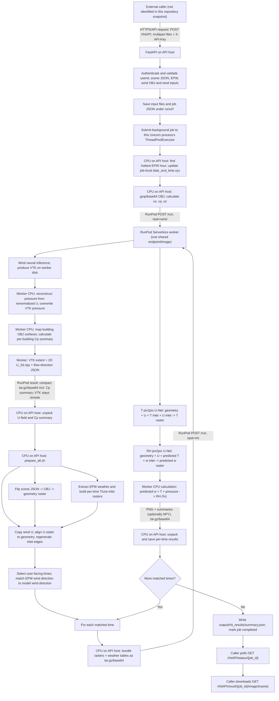

# UHI wind -> temperature -> relative-humidity pipeline walkthrough

This describes the execution path in this checkout, from the public API request
through the saved result. It follows the production path in `app/`, `scripts/`,
and `worker/`; it does not attempt to annotate every layer of the underlying
neural-network implementation.

## The short version

**The API and geometry/weather preparation run on the API host (intended to be
an AWS/Linux CPU host). The wind, T and humidity-ratio neural networks run in a
RunPod Serverless worker.** The host makes one RunPod call for wind and one
RunPod call per selected timestep for T followed by the RH workflow. The T
prediction stays on the worker until the RH workflow has consumed it.

There is an important naming nuance: the RH model does **not** directly output
relative humidity. It predicts humidity ratio `w`; `RH_model/predict_RH.py`
then computes RH (%) using that predicted `w`, the predicted T raster, and
EPW atmospheric pressure.

## Flowchart

RunPod is called through its **HTTP API**, not through a separate T, RH, or
WindAI HTTP service. Both task types target the configured
`RUNPOD_ENDPOINT_ID` and use the same worker image.

## Execution, in order

### 1. Service startup and request acceptance

1. `start_api.sh` sources `.env` and starts Uvicorn; the deployment script
   starts the same `app.main:app` with PM2. The documented defaults are port
   8090 and two Uvicorn workers. `deploy_aws.sh` explicitly says this host
   installs no Torch and performs CPU preparation only.
2. FastAPI checks the `X-API-Key` header. The request to `POST /rhtAPI` must
   include a scene JSON (uploaded file or string), an `.epw`, a wind `.obj`,
   wind direction and speed, and `userid`. Project/model IDs are optional.
3. It validates the fields, reads the uploads, normalizes EPW text encoding,
   and saves `scene.json`, `weather.epw`, and `wind.obj` under
   `runs/<userid>/<project_id-or-default>/<job_id>/input/`.
4. It writes a JSON job record and submits `_run_job` to a
   `ThreadPoolExecutor`. The HTTP request returns **202** with `{job_id,
   status:"pending"}`; it does not wait for inference. The default executor
   limit is two jobs per Uvicorn process.

### 2. Select the hottest date and make the wind prediction

5. The background thread marks the job `running` and calls `app.pipeline.run`.
   It copies `scripts/date_and_time.xyz` into the run output folder and invokes
   `scripts/update_date_time.py` on that copy. The script scans valid EPW dry
   bulb records, selects the first maximum, replaces the date, and—when the
   template has exactly three hours—replaces the middle hour with the peak
   hour. The checked-in template currently lists `09 13 17`.
6. `app.wind_ai.run_summer_wind` converts the submitted direction and speed
   into `ux = speed*cos(direction)`, `uy = speed*sin(direction)`, `uz = 0`.
   It gzip-compresses and base64-encodes the OBJ and forms a `task:"wind"`
   payload. The default raster resolution is 512 and default VTK z-index is 1.
7. `app.runpod_client.call` submits this task to RunPod. On the worker,
   `worker.handler._wind_job` decodes the OBJ and invokes
   `wind_api/model/infrenace.py:run_inference`. The wind model preprocesses
   the OBJ, prepares its mesh/grid, runs its diffusion model, and writes a VTK.
8. The worker invokes `pressure_calculator/run_pressure.py` on its CPU,
   using the renormalized `U` from the VTK and anchoring inlet pressure at
   101325 Pa. It writes a temporary VTK, preserving `U`, `U_mag`, and `solid`,
   then replaces `result.vtk` only after successful output.
9. `pressure_calculator/facade_cp.py` maps the uploaded wind OBJ's objects
   whose names contain “building” to the reconstructed pressure field (so
   named tree objects are excluded) and writes an area-weighted wall-Cp
   summary to `out/facade_cp_summary.txt`. The worker then runs
   `scripts/vtk_extent.py` and `scripts/vtk_to_2d.py` on the updated VTK to
   create `U_2d.npy`, `U_flow_direction.json`, and `wind_extent.txt`.
   The VTK (about 27 MB according to the worker comments) remains in the
   worker's temporary disk; the compact rasters and Cp summary return to the
   host. No S3 transfer is used in this path.

### 3. CPU-side scene/weather preparation and matching

10. `scripts/prepare_all.sh` runs as a subprocess on the API host with
   `WIND_2D_DIR` and the job-local date file in its environment. In order:
   - `flip_json.py`: produces flipped scene JSON.
   - `json_to_obj.py`: produces the refined building OBJ geometry.
   - `extractWeatherData.py`: reads the EPW and date/hour list; uses pvlib for
     solar position; derives wet-bulb temperature and specific humidity; and
     writes per-date weather tables.
   - `rasterize_obj.py`: makes the 512x512 geometry-label raster using the
     wind model's XY extent.
   - `field_to_2d_aligned.py`: makes per-timestep T, u and w inlet arrays.
   - Copies the returned wind U raster and flow metadata, then runs
     `wind_inlets.py`.
11. Back in `app.pipeline.run`, `align_wind_fields` compares the geometry's
    building mask with the solid mask in U. It accepts identity or a safe
    vertical/horizontal/180-degree mirror/rotation when overlap is adequate;
    otherwise it fails rather than producing a misaligned map. The flow
    vector and inlet-edge metadata are adjusted with the selected transform.
12. `select_matches` considers the real user-facing hours in the date file.
    For each it compares the EPW wind vector against the model's single
    predicted wind direction and selects the closest direction (speed is
    ignored). Calm/no-data and initial-condition-only timesteps are skipped.
    The default maximum match angle is 180 degrees; match quality is labelled
    good at <=22.5 degrees and fair at <=45 degrees.

### 4. Per-time T, humidity-ratio and RH inference

13. For each selected time, `_build_view_raster` gathers the geometry raster,
    aligned U raster/flow JSON, and the T/u/w inlet arrays. The host bundles
    these with `date_and_time.xyz` and the needed weather tables, then encodes
    the archive into the `task:"rht"` JSON payload.
14. `worker.handler._rht_job` safely unpacks the request into the worker's
    temporary folder and executes `scripts/run_predict_T.py`. That script
    checks inputs, reads wind direction, and chooses the corresponding
    timestep/inlet. It calls `T_model/predict_T.py` with:
    - six geometry one-hot channels;
    - U field and a fluid/solid mask;
    - T inlet values and inlet mask;
    - U inlet values and inlet mask.
    The 12-channel pix2pix U-Net predicts T. It denormalizes to Kelvin, masks
    building pixels with NaN, and saves an NPY, PNG and metadata/summary. The
    PNG is rendered in Celsius; the saved T field and summary values remain
    Kelvin.
15. The worker next executes `scripts/run_predict_RH.py`, which reads the T
    summary and T NPY from the same worker disk. It resolves the configured RH
    checkpoint (the packaged `495_net_G.pth` is selected when it is the
    highest numbered checkpoint and no `latest_net_G.pth` is present), reads
    the matched EPW pressure, and prepares w inlet units to match
    `norm_stats.json`.
16. `RH_model/predict_RH.py` builds an 11-channel input: six geometry
    one-hot channels, U, predicted T, fluid/solid mask, w inlet and w-inlet
    mask. The pix2pix U-Net predicts humidity ratio `w`. Then the same module
    calculates RH pixel-by-pixel:
    `e = w*p/(0.62198+w)` and `RH = 100*e/es(T)` (Magnus saturation vapour
    pressure), clips RH to 0..100%, masks buildings, and writes NPY/PNG/JSON.
    Thus RH is a deterministic post-processing calculation from model-predicted
    `w`, T and pressure—not a direct neural-network RH output.
17. The worker returns T/RH PNGs and JSON summaries in a base64-encoded
    tar.gz; NPY files are omitted by default (`RUNPOD_RETURN_NPY=1` includes
    them). The host restores local paths in the summaries, saves results under
    `output/rht_work/<HHMM>/` and copies display images into
    `output/rht_results/<HHMM>_T.png` and `<HHMM>_RH.png`.
18. After all matched hours finish, the pipeline writes
    `output/rht_results/summary.json`. The facade Cp text is also included in
    the completed status response at `result.rht.facade_cp`, with its
    workspace-relative output path. The background thread records the job as
    completed; exceptions mark it failed and trigger RunPod cancellation
    when applicable.

## Where computation runs

| Work | Location | CPU/GPU evidence |
|---|---|---|
| FastAPI, auth, input validation, job JSON, polling, file management | API host | `deploy_aws.sh` deploys Uvicorn/PM2 and states there is no Torch on this host. |
| EPW peak selection, scene conversion, weather extraction, geometry rasterization, inlets, wind-field alignment/matching | API host | Invoked from `app.pipeline` / `prepare_all.sh` using local Python/subprocesses; these are CPU preparation jobs. |
| Wind model inference | RunPod Serverless worker | `infrenace.py` chooses `cuda` when Torch reports CUDA available, otherwise CPU. It logs the detected device. |
| VTK-to-2D conversion | RunPod worker | The worker runs `vtk_extent.py` and `vtk_to_2d.py`; this is VTK/Python data conversion, not a separate API call. |
| T pix2pix inference and RH humidity-ratio pix2pix inference | RunPod worker | Worker selects `PREDICT_DEVICE` if set, otherwise CUDA when available, otherwise CPU; the same device is used for model loading and prediction. |
| PNG rendering and RH equation | RunPod worker | Performed by the prediction scripts in the same worker process; NumPy/Matplotlib/OpenCV post-processing. |

The Dockerfile is based on a CUDA-enabled PyTorch image. The worker README
describes the intended endpoint as GPU-backed, scaling to zero when idle, with
several GPU types enabled. The code itself has a CPU fallback. Therefore the
repository establishes the intended GPU configuration, but not which GPU was
actually allocated for any particular live job.

The worker image includes these checkpoints and normalization data:

- T: `T_model/latest_net_G.pth` and `T_model/norm_stats.json`.
- RH/w: `RH_model/495_net_G.pth` (or the highest numbered
  `<epoch>_net_G.pth` if the deployed folder differs) and
  `RH_model/norm_stats.json`.
- Wind: `wind_api/model/model/best.ckpt` and `stats.pickle`.

The worker README estimates the T/RH checkpoints at about 268 MB each and the
wind checkpoint at about 663 MB. The Docker build checks that each checkpoint
exists and is not merely a Git LFS pointer.

## Exact HTTP/API calls

### Caller -> this service

- `POST /rhtAPI` — submit inputs; returns 202 and a job ID.
- `GET /rhtAPI/status/{job_id}` — poll pending/running/completed/failed status.
- `POST /rhtAPI/cancel/{job_id}` — fail/cancel a job and request cancellation
  of its active RunPod work.
- `GET /rhtAPI/result/{job_id}/image/{name}` — retrieve a completed T or RH
  PNG.
- `GET /rhtAPI/project/{userid}/{project_id}/inference` — generate a text
  summary from the latest completed project run.
- `GET /health` — service/configuration/disk health.

The codebase snapshot does not identify which external frontend/service makes
these calls.

### This service -> RunPod

`app.runpod_client` uses
`RUNPOD_API_BASE` (default `https://api.runpod.ai/v2`) plus
`RUNPOD_ENDPOINT_ID`:

- `POST /{endpoint_id}/run` with `{input: payload, policy: ...}` to submit a
  wind or RHT task.
- `GET /{endpoint_id}/status/{runpod_job_id}` to poll until completion.
- `POST /{endpoint_id}/cancel/{runpod_job_id}` to cancel when a job is
  cancelled, times out, fails while waiting, or the API host shuts down.

The API key is read from `RUNPOD_API_KEY`; it is not embedded in source. The
client enforces a 9 MiB JSON payload ceiling, retries refused submissions for
HTTP 429/503, polls with a delay that grows from one to four seconds, and
cancels jobs on wait errors/timeouts. The wind call's default timeout is 1800
seconds; the T+RH call's default is 900 seconds.

The worker receives `event["input"]`. `task:"wind"` selects wind processing;
`task:"rht"` selects the combined T-then-RH workflow. It returns output to the
RunPod job response; the worker does not call the API host back.

## Files and responsibilities

| File(s) | Responsibility |
|---|---|
| [`app/main.py`](./app/main.py) | FastAPI routes, authentication, validations, on-disk job lifecycle, background thread, cancellation and result serving. |
| [`app/pipeline.py`](./app/pipeline.py) | Orchestrates hottest-day selection, remote wind, local preparation/alignment, timestep matching, remote T+RH, final summary. |
| [`app/wind_ai.py`](./app/wind_ai.py) | Converts direction/speed and creates the remote wind task payload. Despite the module name, this is a client/helper, not an API server. |
| [`app/runpod_client.py`](./app/runpod_client.py) | RunPod HTTP submit/status/cancel, archive bundling/extraction, and per-time T+RH payloads. |
| [`scripts/prepare_all.sh`](./scripts/prepare_all.sh) | Ordered local CPU preparation pipeline. |
| [`scripts/run_predict_T.py`](./scripts/run_predict_T.py), [`scripts/run_predict_RH.py`](./scripts/run_predict_RH.py) | Worker-side CLI orchestration for each predictor and transfer of the selected timestep/result paths. |
| [`worker/handler.py`](./worker/handler.py) | RunPod Serverless entry point; warms models, dispatches task, returns packed outputs. |
| [`wind_api/model/infrenace.py`](./wind_api/model/infrenace.py) | Wind model preprocessing, checkpoint/model load, inference and VTK output. |
| [`T_model/predict_T.py`](./T_model/predict_T.py) | T model input tensor, checkpoint loading, prediction, denormalization and files. |
| [`RH_model/predict_RH.py`](./RH_model/predict_RH.py) | w model input tensor, prediction, RH calculation and result files. |
| [`worker/Dockerfile`](./worker/Dockerfile), [`worker/README.md`](./worker/README.md) | Worker image, included model weights, and documented RunPod setup. |
| [`deploy_aws.sh`](./deploy_aws.sh), [`start_api.sh`](./start_api.sh) | API-host deployment/start commands. |

### Entry-point and code-section map

These are the main execution ranges to read in order; helper functions and
comments around them provide the validation/error-handling details:

1. [`app/main.py` request inputs and validation](./app/main.py#L500) -> [save job and submit background work](./app/main.py#L600) -> [background `_run_job`](./app/main.py#L383).
2. [`app/pipeline.py` hottest-hour preparation](./app/pipeline.py#L94) -> [wind alignment](./app/pipeline.py#L170) -> [direction matching](./app/pipeline.py#L226) -> [per-time result assembly](./app/pipeline.py#L300) -> [pipeline orchestration](./app/pipeline.py#L341).
3. [`app/wind_ai.py` wind payload construction](./app/wind_ai.py#L25) -> [`app/runpod_client.py` archive packing](./app/runpod_client.py#L185) -> [RunPod HTTP submit/poll/cancel](./app/runpod_client.py#L237) -> [T+RH request](./app/runpod_client.py#L377).
4. [`worker/handler.py` model warm-up](./worker/handler.py#L80) -> [wind task](./worker/handler.py#L124) or [RHT task](./worker/handler.py#L155) -> [worker dispatch](./worker/handler.py#L187).
5. [`T_model/predict_T.py` T input tensor and checkpoint](./T_model/predict_T.py#L152) -> [T inference and output](./T_model/predict_T.py#L350); [`RH_model/predict_RH.py` RH/w input tensor and checkpoint](./RH_model/predict_RH.py#L200) -> [w inference and RH calculation](./RH_model/predict_RH.py#L408).

## What this checkout cannot tell us

- The actual secret values or live values in `.env` (including endpoint ID,
  active timeout overrides and API keys).
- The live RunPod endpoint's currently deployed image tag, GPU assignment,
  worker count, region, or whether the dashboard configuration still matches
  the README.
- Which external client calls this API or what base URL/DNS/TLS proxy it uses.
- A specific job's actual device without that job's worker log; worker logs
  record the selected device/GPU and CPU count.

Those details require the deployment environment, RunPod dashboard, caller
configuration, or logs. The code and deployment files are sufficient to
identify the intended processing route above, but not to assert the live values.
